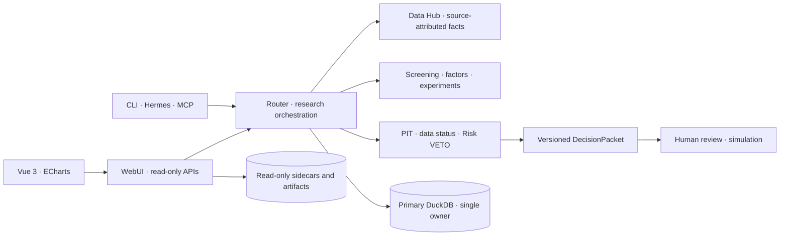

<div align="center">


# AIQUANT-LITE

### An AI-native research workspace for China's A-share market

**Turn market data into research. Turn research into traceable decisions.**

Market intelligence, quantitative factors, AI-assisted research, risk constraints and decision review in one local-first workspace.

[](pyproject.toml)
[](frontend/package.json)
[](router/api/app.py)
[](database/connection_manager.py)
[](LICENSE)
[](https://github.com/Shixi216/aiquant-lite/actions/workflows/ci.yml)

[简体中文](README.md) · English

</div>

## Research, connected

Built for individual researchers, quantitative developers and small research teams, AIQUANT-LITE connects **market observation → screening → company research → risk review → decision records → simulation and review**.

The Vue workspace brings these views together. The Python backend combines structured facts, deterministic calculations and optional specialized model roles, retaining source attribution, timestamps, coverage and availability so that results remain open to inspection.


<details>
<summary><strong>Stock intelligence and chart preview</strong></summary>


</details>

> Screenshots show the actual UI with development contract samples. Values illustrate layout and interactions; they are not live quotes, advice or performance results. Fixture mode is disabled in production.

## Workspace capabilities

| View | Research workflow |
|---|---|
| **Market dashboard** | Breadth, price-change distribution, coverage, timestamps and provider state |
| **Opportunity ranking** | Deterministic market screening, candidate filters and four-dimensional cross-sectional ranks |
| **Stock intelligence** | Security identity, quote snapshots, financial records, factor details, frozen decision zones and candlestick charts |
| **Quant lab** | Market sentiment, margin financing, Dragon-Tiger trading activity and daily-bar research panels |
| **Strategy and capital research** | Research artifacts, sentiment experiments, Walk-Forward evaluation, cost sensitivity and strategy comparison |
| **Decisions and review** | Risk VETO, action and sizing constraints, versioned packets, local simulation and user-entered trade facts |

- **Source-attributed data** through Tushare, AKShare / Eastmoney, BaoStock and CNInfo adapters; optional Jinniu history integration remains experimental and requires separate configuration.
- **Configurable AI roles** for synthesis, filing verification and risk review; provider access depends on credentials and service availability.
- **Explicit time semantics** for trade dates, quote snapshots, score cutoffs and report generation, with Point-in-Time input contracts.
- **Traceable decisions** with frozen zones, versions, linked evidence and hash verification.
- **Visible degradation** when data is missing, stale or unavailable. Missing values remain missing.
- **Composable access** through WebUI, CLI, FastAPI, Finance Data MCP, Hermes and desktop source modules.

## Reference architectures

The following projects provide architectural reference points. This is a comparison of direction, not a claim of feature, coverage, speed or investment-performance parity.

| Project | Official focus | AIQUANT-LITE's focus |
|---|---|---|
| **[Microsoft Qlib](https://github.com/microsoft/qlib)** | AI-oriented quantitative investment research with multiple ML paradigms | Connect factors and experiments to inspectable A-share research decisions |
| **[OpenBB](https://github.com/openbq-org/OpenBB)** | Data integration infrastructure for analysts, quants and AI agents | Organize A-share sources, availability and research views in a local workspace |
| **[QuantConnect LEAN](https://github.com/QuantConnect/Lean)** | Modular algorithmic trading, backtesting and execution infrastructure | Retain strategy evidence, risk constraints and review records within research and simulation |

These are references, not dependencies or partners. AIQUANT-LITE supports research and human decisions; the public implementation has no broker connection or automated live-order path.

## Architecture



Router is the sole online owner of the primary DuckDB. WebUI fact and scoring requests go through Router; approved read-only sidecars and research files serve chart and experiment views. Stop online database owners before direct offline maintenance.

### Scoring contracts

| Path | Meaning |
|---|---|
| `cross_section_4d` | Technical / fundamental / sentiment features / margin-financing ranks, weighted 30 / 30 / 25 / 15 over available inputs; cutoff queries read a historical section at or before that time |
| `legacy_60_40_fallback` | 60% technical + 40% fundamental fallback, explicitly marked `degraded` when the cross section is unavailable |
| Orchestration experiments | Separate two-factor, 50 / 35 / 15 three-factor and custom-weight research paths |

Actions also depend on data state, position context, percentile thresholds and Risk VETO. See [architecture](docs/architecture.md) and [limitations](docs/limitations.md).

## Quick start

Requires **Python 3.11** and [uv](https://docs.astral.sh/uv/). Web builds also require **Node.js 22.12+** and npm. Managed operations scripts target Windows; Python services can be launched individually on other systems.

```powershell
git clone https://github.com/Shixi216/aiquant-lite.git
cd aiquant-lite
uv sync --dev --frozen
Copy-Item .env.example .env
npm --prefix frontend ci
npm --prefix frontend run build
```

Configure only the data and model credentials you need in your local `.env`. Licensed data, personal databases and private research results are not distributed; a full research workflow requires your own data-source configuration and local data setup.

On Windows:

```powershell
powershell -ExecutionPolicy Bypass -File scripts\start_hermes_opc.ps1
powershell -ExecutionPolicy Bypass -File scripts\status_hermes_opc.ps1
```

Open **http://127.0.0.1:8767**. Router defaults to `8765`; Data Hub uses `8766`. Run `uv run python -m scripts.preflight_check` to inspect configuration and service state.

Alternatively, start each service in its own terminal:

```powershell
uv run python -m scripts.run_router_api
uv run python -m scripts.run_data_api
uv run python -m scripts.run_web_ui --host 127.0.0.1 --port 8767
```

### UI-only demo

After building the frontend, start development contract samples without credentials or Router:

```powershell
$env:WEBUI_DEV_FIXTURES="1"
$env:HERMES_ENV="development"
$env:ROUTER_URL="http://127.0.0.1:9"
uv run python -m scripts.run_web_ui --host 127.0.0.1 --port 8877
```

Visit `http://127.0.0.1:8877`. Dashboard, opportunities and the sample stock view use fixtures; other views degrade with missing data. Use a fresh terminal or clear those variables before normal operation.

## Repository map

```text
frontend/                  Vue 3 + TypeScript + ECharts workspace
webui/                     GET-only view APIs, charts and artifact readers
router/                    Model routing, research workflows, audits and APIs
data_hub/                  Quotes, history, financials, filings and market facts
trading/scanner/            Screening and candidate ranking
trading/decision_support/   Scores, risk, actions, sizing and packets
trading/research/           Factors, sentiment, fundamentals and experiments
trading/simulation/         Local paper accounts and portfolio research
manual_tracking/           Facts entered by the user about external trades
desktop/                   PySide6 desktop source
database/migrations/       Schema migrations
scripts/                   Operations, research and validation commands
tests/                     Unit, API, isolation and regression checks
```

## Validation

Long combined test processes hit native crashes in the reviewed Windows / Python 3.11.1 environment. The supplied runner isolates test modules; the audit records both the completed checks and this unresolved limitation.

```powershell
uv run ruff check .
uv run python -m scripts.run_offline_tests --workers 2
uv run python -m scripts.check_no_live_execution
npm --prefix frontend test
npm --prefix frontend run build
```

Run validation in an isolated environment with temporary databases. See the [release audit](docs/release-audit-2026-10-18.md) for this publication's exact scope and results. Offline checks do not establish external-provider connectivity, live data quality or long-term strategy performance.

## Documentation and direction

[Architecture](docs/architecture.md) · [API](docs/api-reference.md) · [Data pipeline](docs/data-pipeline.md) · [Operations](docs/operations.md) · [Hermes](docs/hermes-integration.md) · [Experiments](docs/experiments.md) · [PIT fundamentals](docs/fundamental-point-in-time.zh-CN.md)

Next priorities: data-quality measurement, consistent score provenance, longer strategy evidence, reproducible research and workspace interaction improvements. Roadmap items are not delivered features.

## Security and license

Keep credentials in local `.env`; exclude databases, logs, caches, runtime state and private research outputs from the public repository. Services bind to loopback by default. Remote use requires authentication and network controls. See [SECURITY.md](SECURITY.md) and [CONTRIBUTING.md](CONTRIBUTING.md).

For research, education, backtesting, simulation and human decision support. Not investment advice; no return guarantees. Third-party data and model use remains subject to the respective service terms. Source code is licensed under [MIT](LICENSE).
