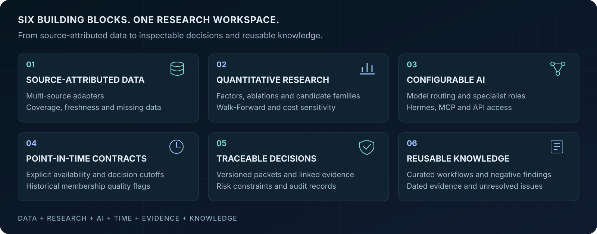
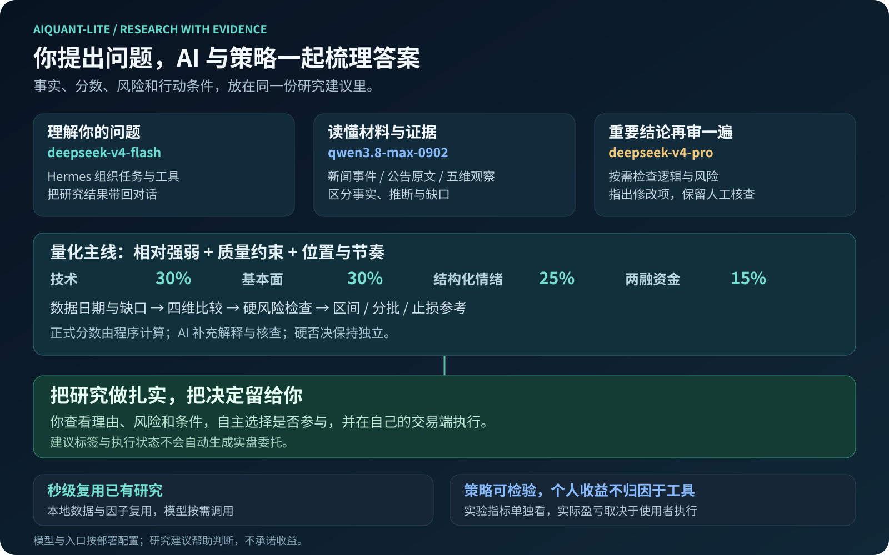
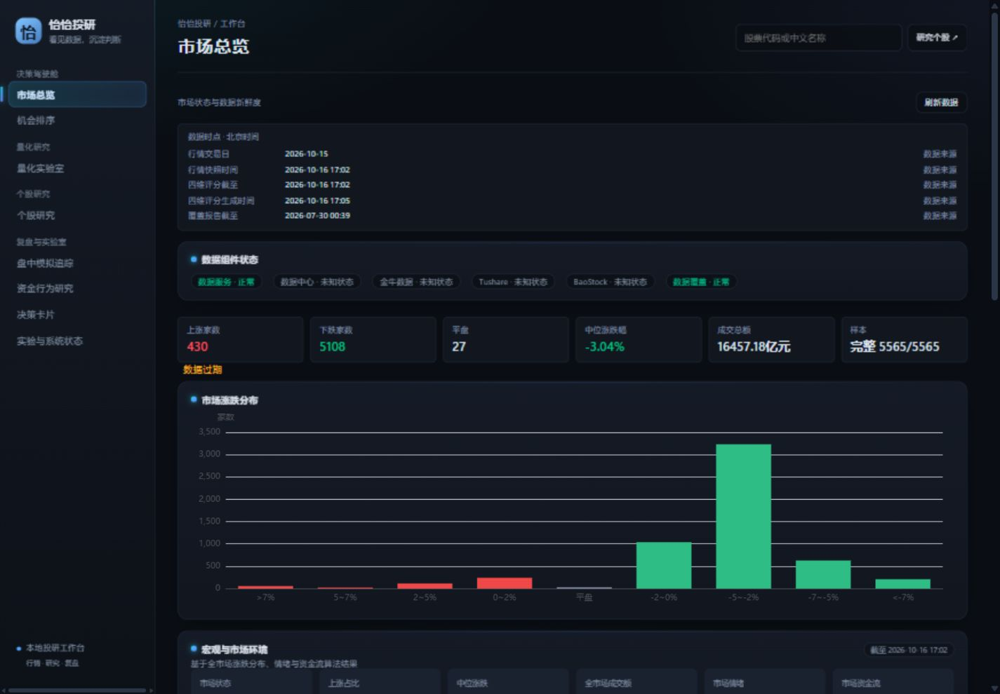
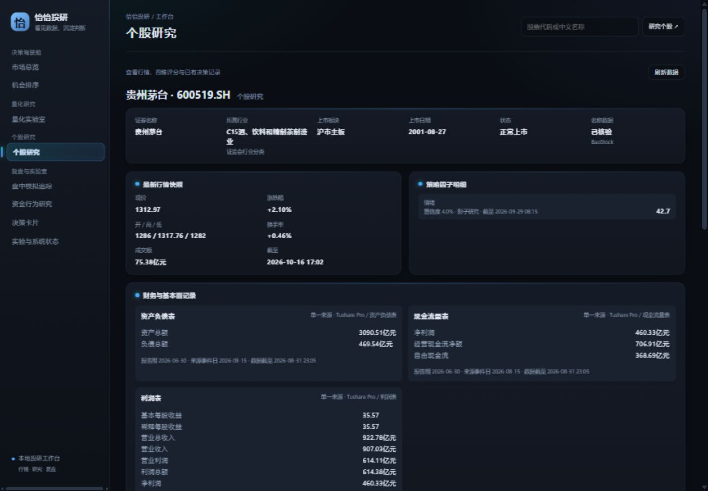
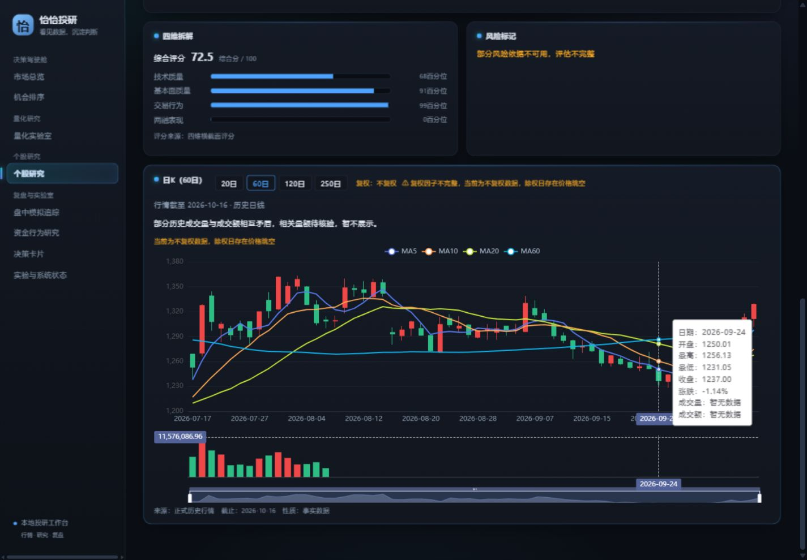
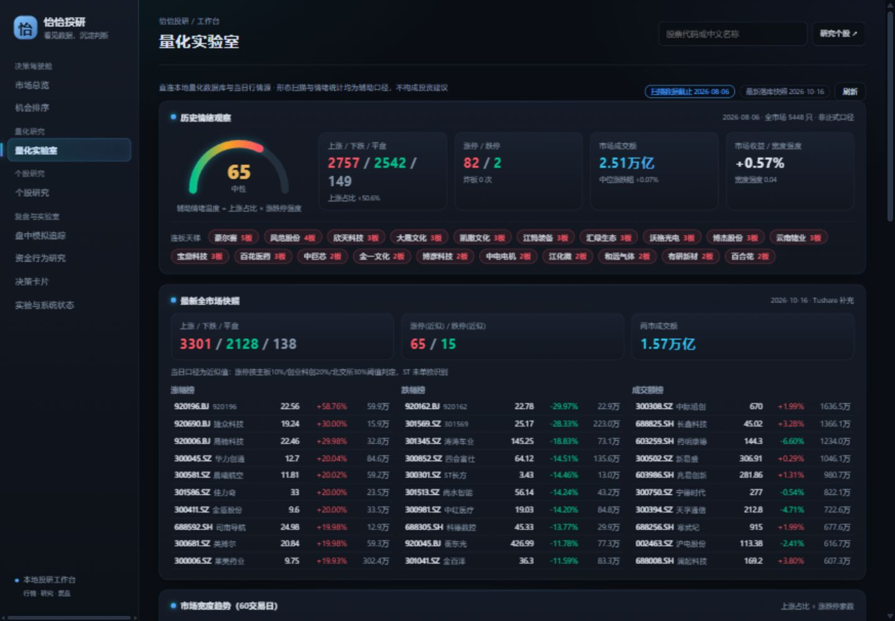
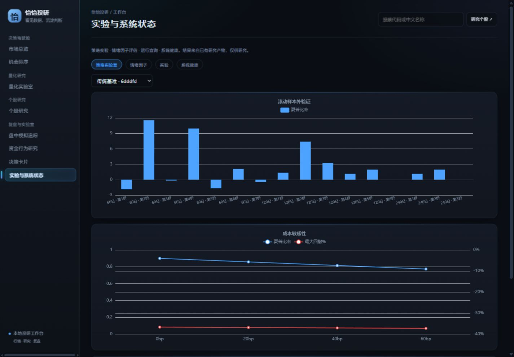
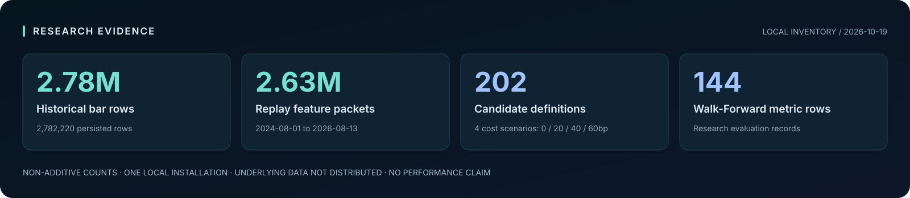
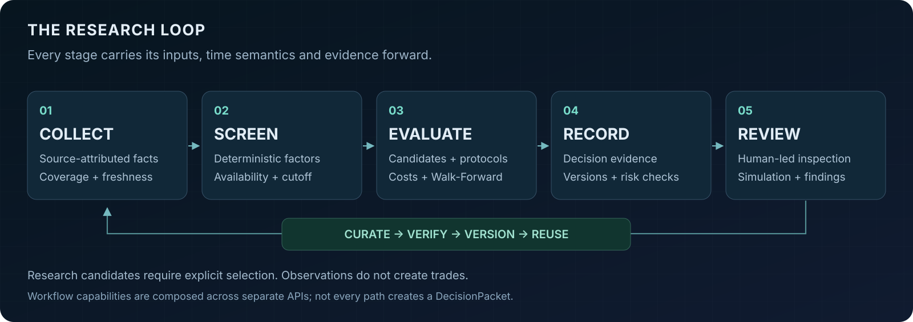
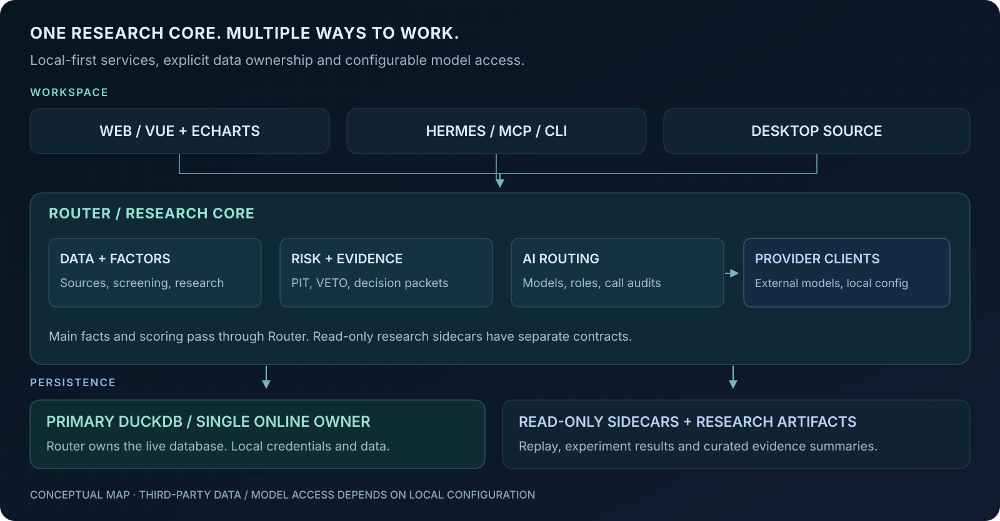

<div align="center">


# AIQUANT-LITE

### Build your own AI research command center for China's A-share market.

**Million-row data assets × Quantitative experiments × Configurable AI × Traceable decisions**

From market context to company research. From factor ideas to inspectable evidence. A local-first workspace for serious research.

[](https://github.com/Shixi216/aiquant-lite/actions/workflows/ci.yml) [](pyproject.toml) [](frontend/package.json) [](router/api/app.py) [](database/connection_manager.py) [](docs/hermes-integration.md) [](LICENSE)

**[🚀 Quick start](#quick-start) · [🤖 AI roles](#how-ai-work-is-divided-actual-models-and-live-results) · [🖥️ Product tour](#see-the-workspace) · [🧠 Research evidence](docs/knowledge/README.md) · [🏗️ Architecture](#one-research-core-multiple-interfaces) · [💬 Our story](#the-story-behind-the-project) · [简体中文](README.md)**

</div>

---

## Research that leaves an evidence trail

For **A-share researchers, quantitative developers and small research teams**, AIQUANT-LITE connects a data platform, quantitative workbench and Agent workflows. Source attribution, experiments, risks and decisions become parts of a research process you can inspect and improve.



| Research depth | Engineering foundations |
|---|---|
| **🔎 Source-attributed facts**<br>Quotes, financials, filings, news and risk information retain source, coverage and time semantics. | **🧠 Configurable models and access**<br>Router organizes research roles; Web, CLI, Hermes, MCP and desktop source reuse research infrastructure. |
| **🧪 Experiments with trade-offs**<br>Static, dynamic, model and ablation routes retain cost sensitivity, yearly stability and rejection reasons. | **⏱️ Point-in-Time contracts**<br>Availability, cutoffs and historical membership quality constrain inputs; missing and stale data remain visible. |
| **🧾 Inspectable decisions**<br>Versioned DecisionPackets preserve zones, evidence and integrity checks for human review. | **🔐 Local-first data ownership**<br>Router is the sole online owner of the primary DuckDB; sidecars expose research under separate read-only contracts. |

## How AI work is divided: actual models and live results

**DeepSeek Flash organizes tasks, Qwen structures and verifies evidence, and DeepSeek Pro reviews the conclusions.** Dedicated modules handle data, quantitative scores, hard risk VETO and decision evidence. These are the **actual local settings and live checks on 2026-10-19**, rather than repository defaults or a list of planned roles.



| Stage | Actual request model | Responsibility | Live result |
|---|---|---|---|
| Hermes task planning | **`deepseek-v4-flash`**; response identifier `deepseek-flash` | Arrange news, filing, synthesis and review responsibilities | Native Hermes produced four planning steps; tools and memory were disabled, so this is not MCP execution |
| News · `news_processor` | **`qwen3.8-max-0902`** | Extract events, retain source classes and cluster duplicate material | One structured event from a real historical filing title and metadata; schema passed, missing body retained |
| Filings · `announcement_verifier` | **`qwen3.8-max-0902`** | Check official PDF text, claim evidence and temporal meaning | Two `SUPPORTED` claims, with current-status / forward-looking classification and document hashes |
| Synthesis · `research_synthesizer` | **`qwen3.8-max-0902`** | Organize five evidence dimensions, missing inputs and risks | Five observations and six missing items from a local report; dates retained and schema passed |
| Risk · `risk_controller` | **`deepseek-v4-pro`** | Independently inspect the prior output and identify required changes | Same-task review completed: `revise`, five findings and four required actions; human review remains required |

The review caught a concrete reasoning error: Qwen described a static DIF / DEA relationship as a crossover event. It also marked a partially available capital-flow dimension as wholly missing. DeepSeek Pro requested a static description and a `PARTIAL` state. The original research remains pending revision; review findings do not automatically rewrite it or complete human approval.

**Final selected checks: five passed, one failed.** MiMo `mimo-v2.5` returned **HTTP 402** on a text-adapter check; no image recognition was tested. Visual roles lack generic image input and handlers. LongCat is unconfigured and unbound; Hy3 remains disabled. Neither is presented as a verified active model.

News and filing checks used existing services. The patched research / risk chain ran from the public-source build in an isolated Router with a temporary database. The filing is a 2025 historical example; report quotes are dated 2026-10-16, financials 2026-06-30, and sentiment was cached. These checks do not establish live-market freshness, long-term availability or investment performance.

The update fixes the risk review's fixed 1,024-token ceiling, exact-symbol propagation and legacy-weight injection in research prompts. **17 scoped checks and Ruff passed.** The original resident Router has not loaded these patches.

[Model and routing guide (Chinese)](docs/ai-roles-and-routing.zh-CN.md) · [Live validation and fixes (Chinese)](docs/live-model-validation-2026-10-19.md) · [Machine-readable evidence](docs/model-validation-2026-10-19.json)

## See the workspace

**Market context → screening → company research → risk review → decision records → simulation and review.**



<table width="100%">
<tr>
<td width="50%" align="center"><strong>Stock intelligence · facts and factors</strong><br></td>
<td width="50%" align="center"><strong>Price research · connected chart views</strong><br></td>
</tr>
</table>

<details>
<summary><strong>Expand the stock research previews</strong></summary>


</details>

> Captured on 2026-10-19 from the production-built Chinese WebUI using existing local data, with fixtures disabled. Business dates, missing data and stale-data notices remain visible. Screenshots are not a live feed or strategy-performance result; diagrams show conceptual architecture.

<details>
<summary><strong>Quantitative panels and strategy research</strong></summary>





</details>

### Six connected workspaces

| Workspace | What you can investigate | Implementation |
|---|---|---|
| **Market dashboard** | Breadth, coverage, quote timestamps and provider state | [Dashboard](frontend/src/views/DashboardView.vue) |
| **Opportunity ranking** | Deterministic market scans, filters and four-dimensional cross-sectional ranks | [Scanner](trading/scanner) · [Cross Section](trading/research/orchestration/cross_section.py) |
| **Stock intelligence** | Security identity, financials, factors, decision zones and candlestick charts | [Stock Intelligence](frontend/src/views/StockIntelView.vue) |
| **Quant lab** | Sentiment, margin financing, Dragon-Tiger activity and daily-bar panels | [Quant Lab](frontend/src/views/QuantLabView.vue) |
| **Strategy and capital research** | Candidate families, cost sensitivity and Walk-Forward evidence | [Strategy Lab](trading/research/strategy_lab) · [Research](webui/routes/research.py) |
| **Decisions and review** | Risk VETO, sizing, versioned decisions and local simulation | [Decision Support](trading/decision_support) · [Manual Tracking](manual_tracking) |

## Research depth, in inspectable assets



The local inventory contains **2,782,220 historical bar rows, 2,625,560 Replay feature packets and 2,238,764 aligned Strategy Lab input rows**. Strategy Lab retains **202 candidate definitions, four cost scenarios at 0 / 20 / 40 / 60bp and 144 Walk-Forward metric rows**.

[Eight curated knowledge topics](docs/knowledge/README.md) cover data scope, PIT, experiment protocols, negative findings, operations, Hermes workflows, Forward observations and memory governance. Rejection reasons and unresolved questions remain part of the research record. Detailed knowledge articles are currently in Chinese.

> Counts come from a **read-only inventory of one local installation on 2026-10-19**. Related tables are non-additive; candidate and metric counts are not counts of profitable strategies. Underlying data is not distributed. See [data scope](docs/knowledge/data-assets.md), [protocol comparison](docs/knowledge/experiment-comparison.md) and [machine-readable evidence](docs/knowledge/evidence-snapshot-2026-10-19.json).

## From market facts to reusable research



1. **Collect facts:** retain configured sources, coverage, business dates and freshness.
2. **Screen and research:** deterministic calculations organize candidates; configured model roles separate facts from inference.
3. **Evaluate ideas:** fix samples, labels and costs; check simple baselines, yearly stability and Walk-Forward results.
4. **Record evidence:** relevant decision workflows retain versions, risks and integrity checks.
5. **Review and curate:** inspect observations and simulations, then document verified methods and negative findings.

APIs have separate boundaries. Hermes screening requires explicit selection before decision evaluation; that integration tool creates neither orders nor DecisionPackets. See the [Hermes contract](docs/hermes-integration.md) and [workflow guide](docs/knowledge/hermes-research-workflows.md).

## Reference architectures

We learn from mature open-source infrastructure while focusing on **A-share context, everyday research and decision evidence**.

| Reference | Design direction | AIQUANT-LITE's focus |
|---|---|---|
| **[Microsoft Qlib](https://github.com/microsoft/qlib)** | AI-oriented quantitative research and data-to-model workflows | Connect factors, experiments and readable decisions to a daily A-share workspace |
| **[OpenBB](https://github.com/openbq-org/OpenBB)** | Multi-source data integration for analysts, quants and AI agents | Organize A-share source state across UI, API, Hermes and MCP |
| **[QuantConnect LEAN](https://github.com/QuantConnect/Lean)** | Modular strategy research, backtesting and execution infrastructure | Connect strategy evidence, risk constraints and review within research and simulation |

These are design references. Feature, coverage, performance and investment-return equivalence has not been established. The public implementation supports research and human decisions, with no broker connection or automated live-order path.

## One research core, multiple interfaces



**Vue 3 + TypeScript + ECharts** powers the workspace; **FastAPI + DuckDB** organizes facts, research and evidence. WebUI main-database facts and scoring pass through Router. Approved sidecars serve chart and research artifacts. Source adapters include Tushare, AKShare / Eastmoney, BaoStock and CNInfo; optional Jinniu history remains experimental and separately configured.

<details>
<summary><strong>Engineering details: scores, risk and model audits</strong></summary>

| Path | Meaning |
|---|---|
| `cross_section_4d` | Technical / fundamental / sentiment features / margin-financing ranks, weighted 30 / 30 / 25 / 15 over available inputs; cutoff queries read a historical section at or before that time |
| `legacy_60_40_fallback` | 60% technical + 40% fundamental fallback, explicitly marked `degraded` when the cross section is unavailable |
| Orchestration experiments | Separate two-factor, 50 / 35 / 15 three-factor and custom-weight research paths |

Actions also depend on data state, position context, percentile thresholds and Risk VETO. See [architecture](docs/architecture.md) and [limitations](docs/limitations.md).

Model roles and provider access depend on local configuration and credentials. The physical call audit includes task and standalone research calls, known usage, failure causes and unlinked counts, with sanitized error display. See the [call audit API](docs/api-reference.md#recent-model-calls). Stop online owners before direct offline maintenance of the primary database.

</details>

## Quick start

Requires **Python 3.11** and [uv](https://docs.astral.sh/uv/). Web builds also require **Node.js 22.12+** and npm. Managed operations scripts target Windows; Python services can be launched individually on other systems.

```powershell
git clone https://github.com/Shixi216/aiquant-lite.git
cd aiquant-lite
uv sync --dev --frozen
Copy-Item .env.example .env
npm --prefix frontend ci
npm --prefix frontend run build
```

Configure only the data and model credentials you need in your local `.env`. Licensed data, personal databases and private research results are not distributed; a full research workflow requires your own data-source configuration and local data setup.

On Windows:

```powershell
powershell -ExecutionPolicy Bypass -File scripts\start_hermes_opc.ps1
powershell -ExecutionPolicy Bypass -File scripts\status_hermes_opc.ps1
```

Open **http://127.0.0.1:8767**. Router defaults to `8765`; Data Hub uses `8766`. Run `uv run python -m scripts.preflight_check` to inspect configuration and service state.

Alternatively, start each service in its own terminal:

```powershell
uv run python -m scripts.run_router_api
uv run python -m scripts.run_data_api
uv run python -m scripts.run_web_ui --host 127.0.0.1 --port 8767
```

### UI-only demo

After building the frontend, start development contract samples without credentials or Router:

```powershell
$env:WEBUI_DEV_FIXTURES="1"
$env:HERMES_ENV="development"
$env:ROUTER_URL="http://127.0.0.1:9"
uv run python -m scripts.run_web_ui --host 127.0.0.1 --port 8877
```

Visit `http://127.0.0.1:8877`. Dashboard, opportunities and the sample stock view use fixtures; other views degrade with missing data. Use a fresh terminal or clear those variables before normal operation.

## Validation

The [hosted Windows CI at source commit `53022f7`](https://github.com/Shixi216/aiquant-lite/actions/runs/39104295548) records **1,794 backend passes, zero failures, four skips and eight deselections; five frontend passes and a successful production build**. The top CI badge shows the current branch status.

```powershell
uv run ruff check .
uv run python -m scripts.run_offline_tests --workers 2
uv run python -m scripts.check_no_live_execution
npm --prefix frontend test
npm --prefix frontend run build
```

Use isolated environments and temporary databases. Module isolation is the validated test mode; the native crash in long combined processes on the reviewed Windows / Python 3.11.1 environment remains unresolved. See the [source audit](docs/release-audit-2026-10-18.md) and [research publication audit](docs/release-audit-2026-10-19.md) for skipped checks and unverified local-data / network scope. Software validation does not establish data quality or long-term investment performance.

The Chinese WebUI update passed **14 frontend regressions, 58 scoped backend checks and a production build**. See the [WebUI review](docs/webui-review-2026-10-19.md) for browser checks, screenshot provenance and unresolved data-quality scope.

## Repository map

```text
frontend/                  Vue 3 + TypeScript + ECharts workspace
webui/                     GET-only view APIs, charts and artifact readers
router/                    Model routing, research workflows, audits and APIs
data_hub/                  Quotes, history, financials, filings and market facts
trading/scanner/            Screening and candidate ranking
trading/decision_support/   Scores, risk, actions, sizing and packets
trading/research/           Factors, sentiment, fundamentals and experiments
trading/simulation/         Local paper accounts and portfolio research
manual_tracking/           Facts entered by the user about external trades
desktop/                   PySide6 desktop source
database/migrations/       Schema migrations
scripts/                   Operations, research and validation commands
tests/                     Unit, API, isolation and regression checks
docs/knowledge/            Data inventory, protocols, negative findings and knowledge governance
```

## Documentation and direction

[Research evidence](docs/knowledge/README.md) · [Architecture](docs/architecture.md) · [API](docs/api-reference.md) · [Data pipeline](docs/data-pipeline.md) · [Operations](docs/operations.md) · [Hermes](docs/hermes-integration.md) · [Experiments](docs/experiments.md) · [PIT fundamentals](docs/fundamental-point-in-time.zh-CN.md)

Next priorities: data-quality measurement, consistent score provenance, longer strategy evidence, reproducible research and workspace interaction improvements. Roadmap items are not delivered features.

## The story behind the project

My first real encounter with stocks came through the 12th East Money Cup competition. It opened a door from financial concepts in the classroom to the changing reality of financial markets.

The experience that followed included setbacks and expensive lessons. I became more interested in understanding what supported a decision, which information was actually available at the time, and how to evaluate an idea after the outcome was known.

With a financial technology background, I find quantitative trading fascinating: it turns financial questions into testable hypotheses and translates intuition into data, rules and experiments. Each result can become a starting point for the next investigation.

That is how AIQUANT-LITE began. I wanted a research workspace of my own: one that organizes market and financial information, tests ideas quantitatively, uses AI to help structure evidence, and retains decisions, risks and reviews. The attention to time boundaries, sources, costs and negative findings reflects what those market lessons taught me.

Markets remain complex and uncertain. This project is both a tool and a record of my learning at the intersection of finance and technology. I hope it helps me research more carefully, reason with better evidence and remain honest about what I do not yet know. If that direction resonates, you are welcome to help build it.

— The author of AIQUANT-LITE

[完整中文自述](docs/project-story.zh-CN.md)

## Build with us

Interested in A-share data quality, quantitative validation, Agent tools or research interfaces? Start with a reproducible issue, clearer data semantics, better evaluation or improved interaction. Read [CONTRIBUTING.md](CONTRIBUTING.md) and open an [issue](https://github.com/Shixi216/aiquant-lite/issues) with evidence and a focused proposal.

If this research direction resonates, a Star helps more researchers discover the project.

## Security and license

Keep credentials in local `.env`; exclude databases, logs, caches, runtime state and private research outputs from the public repository. Services bind to loopback by default. Remote use requires authentication and network controls. See [SECURITY.md](SECURITY.md) and [CONTRIBUTING.md](CONTRIBUTING.md).

For research, education, backtesting, simulation and human decision support. Not investment advice; no return guarantees. Third-party data and model use remains subject to the respective service terms. Source code is licensed under [MIT](LICENSE).
