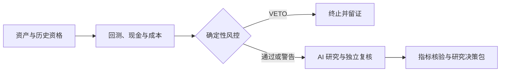
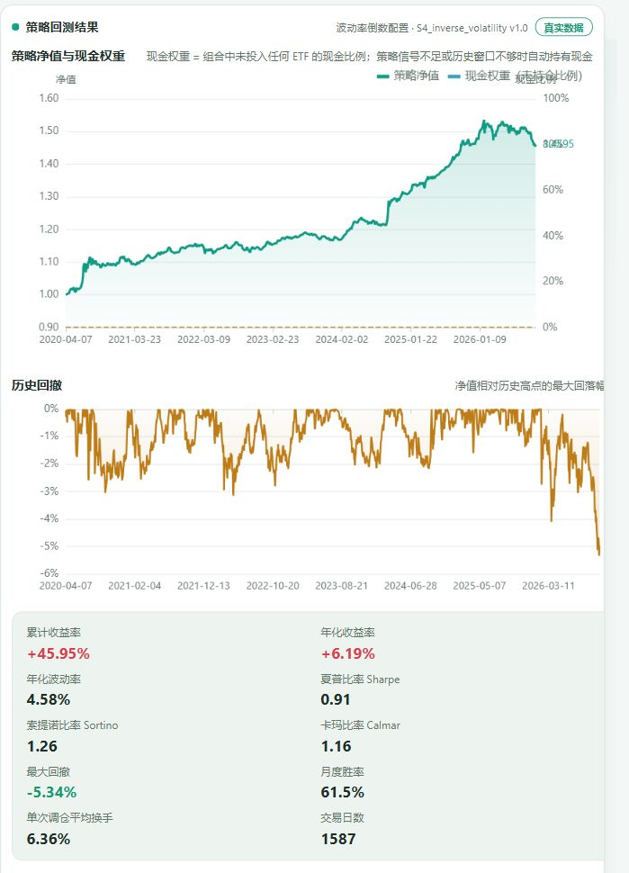
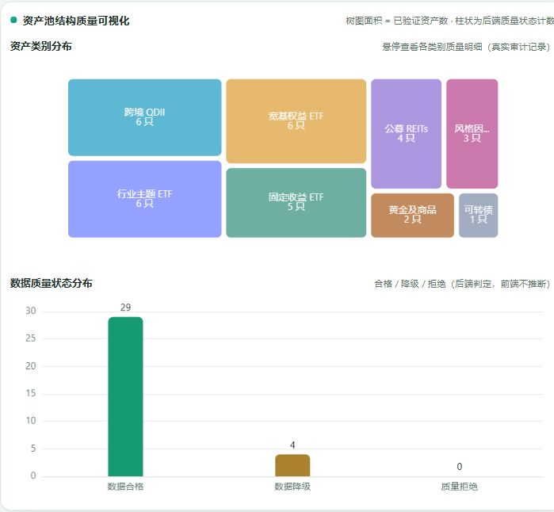
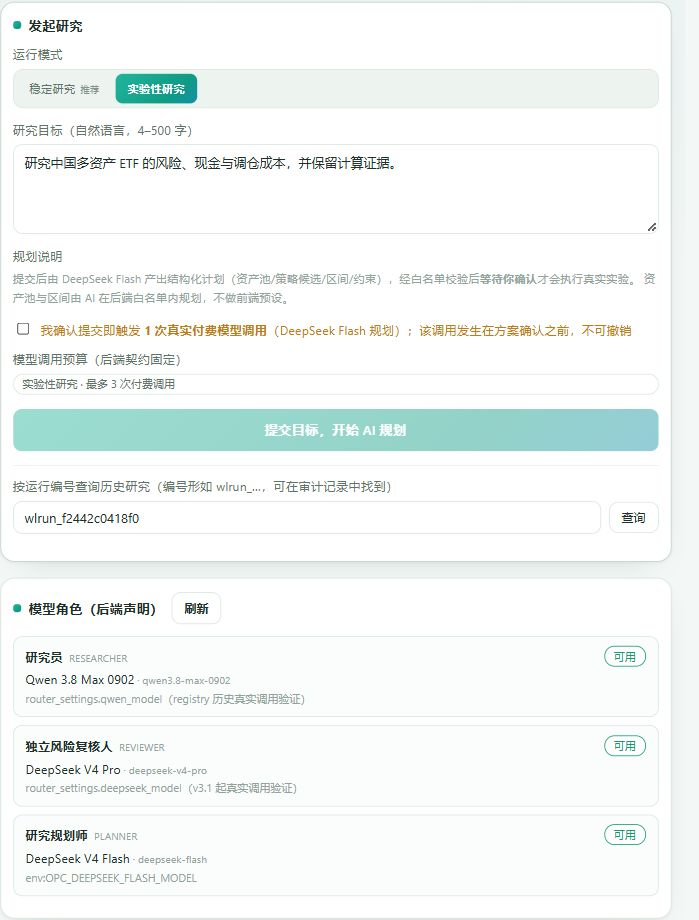
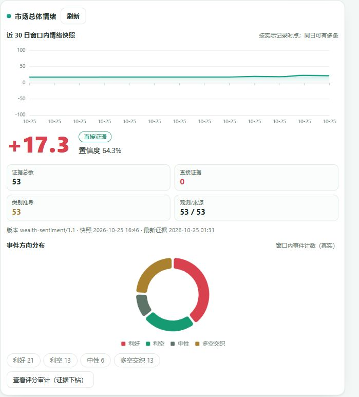
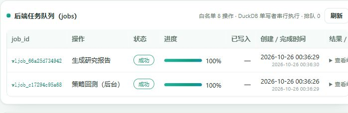

<div align="center">


# AIQUANT-LITE · 怡怡投研

### 为认真研究市场的人，打造自己的 AI 投研中枢。

**百万级数据沉淀 × 量化实验体系 × 多模型研究 × 可追溯决策**

从市场全景到个股深研，从因子试验到证据复盘。帮助你形成有依据的研究判断，最终交易由你自主执行。

[](https://github.com/Shixi216/aiquant-lite/actions/workflows/ci.yml) [](pyproject.toml) [](frontend/package.json) [](router/api/app.py) [](database/connection_manager.py) [](docs/hermes-integration.md) [](LICENSE)

**[🚀 快速部署](#快速开始) · [🤖 AI 分工](#ai-与策略一起帮你把一只股票看清楚) · [🖥️ 界面预览](#眼见为实投研工作台) · [🧠 研究证据](docs/knowledge/README.md) · [🏗️ 系统架构](#一套研究内核多种工作入口) · [💬 项目自述](#项目自述从一次比赛开始) · [🧩 Wealth Lab](#新增-wealth-lab把多资产研究接进同一个工作台) · [English](README.en.md)**

</div>

---

## 让研究的每一步，都有据可查

AIQUANT-LITE 面向 **A 股研究者、量化开发者与小型研究团队**，把数据平台、量化研究台和 Agent 工作流汇入一套本地优先的投研系统。数据、实验、风险和判断在同一条研究链路中衔接，让一次研究留下下一次能够复用的资产。


| 研究深度 | 工程底座 |
|---|---|
| **🔎 多源事实，一处研究**<br>行情、财务、公告、新闻与风险信息保留来源、覆盖与时点，支持继续追问结论依据。 | **🧠 模型可配置，入口可组合**<br>Router 组织研究角色，Web、CLI、Hermes、MCP 与桌面源码复用研究基础设施。 |
| **🧪 策略有比较，复杂度有代价**<br>静态、动态、模型与消融路线接受成本、年度稳定性和 Walk-Forward 检验，失败方案一并留存。 | **⏱️ 时间进入研究契约**<br>PIT 截止、来源可得时间与历史成员质量分别约束输入；缺失与过期显式呈现。 |
| **🧾 判断可以回到证据**<br>版本化 DecisionPacket 固定区间、关联来源并校验完整性，支持人工检查和复盘。 | **🔐 本地数据，清晰所有权**<br>Router 是主 DuckDB 的在线唯一 Owner；研究侧车按各自只读契约提供结果。 |

## AI 与策略，一起帮你把一只股票看清楚

你提出问题，系统把行情、财务、公告和资金线索放到同一张研究桌上。**量化规则给出可解释的比较，AI 帮你整理材料、发现矛盾、追问依据。** 你得到一份能继续核查的研究建议，以及需要自己判断的风险和行动选项。


| 专业分工 | 使用的模型 | 它为你做什么 |
|---|---|---|
| **理解问题，组织研究** | **DeepSeek `deepseek-v4-flash`** | 在 Hermes 中理解你的关注点，组织工具与研究任务，把分散结果带回对话 |
| **读懂材料，梳理证据** | **Qwen `qwen3.8-max-0902`** | 整理新闻事件、核对公告原文、汇总五维观察，让事实、推断和缺失项各有位置 |
| **重要结论，再审一遍** | **DeepSeek `deepseek-v4-pro`** | 按需复核证据、逻辑与风险，指出应当修改或继续核查的地方，保留人工判断 |

这条分工已经出现过具体价值：Qwen 把一个静态指标关系写成“上穿”事件，Pro 在复核中要求改回有依据的描述。**有摘要，也有反问；有观点，也能回到证据。** 复核提出修改意见，原文是否采用、操作是否执行，仍由使用者确认。

### 策略主线：先看健康度，再看强弱与节奏

从项目历史讨论中沉淀出的原则很直接：**题材热度不能替代公司质量，高分不能绕过风险，研究倾向也不等于此刻就该操作。** 当前主线把四维横截面排序、风险约束与价格区间建议连在一起。

| 策略环节 | 关注什么 | AI 如何配合 |
|---|---|---|
| **四维比较** | 技术 30% + 基本面 30% + 结构化情绪 25% + 两融资金 15%，比较个股在截面中的相对位置 | 解释数据与矛盾，补充新闻 / 公告语境；正式分数由量化程序计算 |
| **质量与风险过滤** | 已加载财务中的亏损、盈利急降，龙虎榜明显净卖，以及数据状态与重大风险证据 | 整理原文、区分事实与传闻、提示待核查事项；硬否决保持独立 |
| **位置与节奏** | 根据评分分档、已有持仓、支撑压力和波动率，提供区间、分批与止损参考 | 帮你理解“为什么倾向研究、为什么还需等待或控制规模” |
| **实验与复盘** | 用成本、年度稳定性、样本外与 Walk-Forward 对照研究方案 | 协助解释结果、整理失败原因；实验方案不自动改变正式策略 |

分数由程序计算，缺口如实呈现。AI 新闻分析补充语境与风险，帮助你理解四维结果。[深入了解策略与协作](docs/research-playbook.zh-CN.md)。

### 遇到问题票，先把风险讲明白

一只股票可以走势强、题材热，同时存在不能忽视的问题。个股报告检查已有财报中的归母净利亏损、净利同比低于 −30%，以及龙虎榜区间明显净卖等风险；可信材料中的订单受限、立案等事件也会被强制识别为负面。让“为什么要谨慎”先于漂亮的分数被看见。

例如，在综合分 **+0.95**、同时存在硬否决的合成测试场景中：空仓得到 **回避建议**，已有持仓得到 **退出建议**，新增仓位均不放行。**高分不能替风险免责。** 重大事件还要核对来源，传闻不能仅凭相同措辞就冒充官方证据。

**规则帮助你踩刹车，AI 帮你说明为什么。** 筛查不能保证发现所有问题，也可能需要人工排除误报；“回避／退出”都是建议标签，系统不会替你提交实盘委托。

### 秒级复用，按需深入研究

已有的数据与因子可以复用，模型调用留给文本理解和需要复核的问题。这样既能快速回看一只股票，也能在需要时刷新数据、加入 AI 分析。

| 本机运行样例 | 实测耗时 | 包含什么 |
|---|---:|---|
| **复用已有数据生成报告** | **1.35–2.60 秒**；3 次中位数 **1.43 秒** | 本地数据读取、五维计算与规则建议；这 3 次未观察到模型调用 |
| **在线取数 + Qwen 事件分析** | **28.65 秒**；单次 | 在线取数路径、新闻事件提取、五维计算与报告；不含额外 Pro 深度复核 |

> 2026-10-19 本机样例，行情基准 2026-10-16。两条路径的材料与研究深度不同；模型、网络与缓存会影响耗时，不代表实时行情保证。[测量口径与证据](docs/product-evidence-2026-10-19.md)。

### 研究建议交给你，最终操作由你完成

项目帮助使用者整理事实、理解策略、核查风险和形成行动选项。**最终买卖、仓位、价格与操作时机，由使用者自主决定，并在自己的交易端执行。** 展示中的“建仓”“退出”或“立即执行”都是建议 / 状态标签。

不同使用者的选择、成交价、仓位与成本不同，不能把各自盈亏统一计量或归因成“本项目收益率”。策略实验的收益与回撤用于检验研究假设，另行说明协议；它们不代表使用者能够获得的投资回报。

## 眼见为实：投研工作台

**市场驾驶舱 → 机会排序 → 个股研究 → 风险检查 → 决策留存 → 模拟复盘**，让研究视图跟随工作流程展开。


<table width="100%">
<tr>
<td width="50%" align="center"><strong>个股深研 · 事实与因子同屏</strong><br></td>
<td width="50%" align="center"><strong>行情观察 · 价格与研究联动</strong><br></td>
</tr>
</table>

<details>
<summary><strong>展开查看个股研究大图</strong></summary>


</details>

> 截图于 2026-10-19，来自生产构建的中文 WebUI 与本地已落库数据，未启用演示样本。行情日期、缺失项和过期提示按实际状态保留；截图不代表实时行情或策略收益。流程图展示概念架构。

<details>
<summary><strong>查看量化实验与策略研究界面</strong></summary>


</details>

### 股票研究的六个环节

| 工作区 | 你可以做什么 | 实现入口 |
|---|---|---|
| **市场驾驶舱** | 看涨跌分布、数据覆盖、行情时点和来源状态 | [Dashboard](frontend/src/views/DashboardView.vue) |
| **机会排序** | 全市场确定性扫描、条件筛选、四维横截面 rank | [Scanner](trading/scanner) · [Cross Section](trading/research/orchestration/cross_section.py) |
| **个股研究** | 联看证券身份、财务、因子、决策区间和 K 线 | [Stock Intelligence](frontend/src/views/StockIntelView.vue) |
| **量化实验室** | 查看情绪、两融、龙虎榜与日线研究面板 | [Quant Lab](frontend/src/views/QuantLabView.vue) |
| **策略与资金研究** | 比较策略家族、成本敏感性和滚动验证结果 | [Strategy Lab](trading/research/strategy_lab) · [Research](webui/routes/research.py) |
| **决策与复盘** | 检查风险 VETO、仓位约束、版本化决策与本地模拟 | [Decision Support](trading/decision_support) · [Manual Tracking](manual_tracking) |

## 新增 Wealth Lab：把多资产研究接进同一个工作台

**2026-10-26 更新：保留主线的 A 股研究、AI 分工与证据介绍，融合新版财富工作台。** 股票评分与财富配置各有计算链路，使用同一个前端入口，也各自保留数据、成本和风控口径。

| 新增能力 | 可以核查什么 |
|---|---|
| **多资产研究池** | 33 只登记研究资产，覆盖权益、债券、黄金及商品、QDII、可转债、REITs；查看质量、上市日与逐调仓 PIT 资格 |
| **策略工厂与组合实验** | S0–S8 九策略，净值、回撤、现金、首笔建仓及换仓成本；对比采用相同区间和成本，扩展池逐调仓重评资格 |
| **受控 AI 研究** | 稳定模式基于存档证据；实验模式由 Flash 规划，经白名单和用户确认后运行实验，再由 Qwen 研究、Pro 复核；硬 VETO 与数字核验独立执行 |
| **情绪与任务中心** | 区分直接证据、类别推导和证据不足；查看实际快照时点、任务失败/降级与存档报告。付费调用须明确确认 |





<table width="100%">
<tr><td width="50%"><strong>资产池 · 分类与质量</strong><br><a href="docs/screenshots/20261026/universe.png"></a></td><td width="50%"><strong>AI 研究 · 角色与付费确认</strong><br><a href="docs/screenshots/20261026/ai-research.png"></a></td></tr>
<tr><td><strong>情绪 · 实际快照与证据</strong><br><a href="docs/screenshots/20261026/sentiment.png"></a></td><td><strong>任务 · 真实进度与存档报告</strong><br><a href="docs/screenshots/20261026/task-center.png"></a></td></tr>
</table>

> 五张截图采集于 2026-10-26；日线截至 10月23日，情绪读取 10月25日既有快照。S4 主图区间为 2020-04-07—2026-10-23、1,587 日、单边 5bps、现金零收益；项目 Sharpe 为 0.9133，最大回撤 -5.3351%，不是早期上限失效版本的 1.086 / -2.99%。[截图来源与限制](docs/screenshots/20261026/README.md)。

股票研究的默认正式分来自 **30/30/25/15 四维横截面**，缺失项按可用权重归一；Wealth Lab 的策略权重另由配置引擎产生。两者不共用一套评分公式。财富情绪只服务当前研究，不进入历史策略回测；存续资产登记仍有幸存者偏差。

六个导航工作区现为股票研究、财富管理、数据中心、系统设置、AI 研究、市场情绪，合计 18 条业务路由。后端凭据与行情库仍需自行配置；首次财富数据初始化见 `scripts/wealth_lab_backfill.py` 和 `scripts/wealth_lab_v3_backfill.py`。

[本地代码与运行状态复核](docs/releases/2026-10-26-main-wealth-integration.md) · [财富功能与 Bug 修复清单](docs/releases/2026-10-26-wealth-lab.md)

## 研究实力，落在可核对的积累上


图示保留 **2026-10-19** 的研究资产盘点。**2026-10-26 经 Router 只读接口复核，主库历史日线表为 2,789,466 行**（包含复权类型与历史修订，不是独立交易日数）；Replay 的 **2,625,560 个特征包**和 Strategy Lab 的 **2,238,764 条对齐输入**沿用 10月19日侧库盘点，本轮未重新生成。Strategy Lab 保留 **202 个候选定义、0 / 20 / 40 / 60bp 四档成本、144 行 Walk-Forward 指标**，让方案优劣接受统一协议检查。

项目同时沉淀 [8 个研究知识主题](docs/knowledge/README.md)：数据边界、PIT、实验协议、失败案例、故障治理、Hermes 工作流、Forward 观察和记忆治理。把“为什么有效、为什么不采用、下一步缺什么”一并留存。

> 统计来自 **2026-10-19 单个本地安装的只读盘点**。各表相互关联，不能相加；候选和指标行数不代表有效策略数。原始数据不随仓库分发。查看 [数据边界](docs/knowledge/data-assets.md)、[实验协议](docs/knowledge/experiment-comparison.md) 与 [机器可读证据摘要](docs/knowledge/evidence-snapshot-2026-10-19.json)。

## 从市场事实，到可复用的研究资产


1. **采集事实**：通过已配置数据源读取市场信息，标记来源、覆盖、业务日期和新鲜度。
2. **筛选与研究**：确定性计算组织候选；按配置调用模型角色，区分事实与推断。
3. **验证方案**：固定样本、标签和成本，对照简单基准、年度稳定性与滚动验证。
4. **留存证据**：相关决策流程记录版本、风险与证据，支持完整性核对。
5. **人工复盘**：检查模拟和观察结果，把经核查的方法与失败教训整理为知识。

不同 API 的边界分别定义；Hermes 的筛选结果需明确选择才进入决策评估，该集成工具不创建订单或 DecisionPacket。详见 [Hermes 契约](docs/hermes-integration.md) 与 [研究工作流](docs/knowledge/hermes-research-workflows.md)。

## 向成熟开源基础设施看齐

### 与 TradingAgents 的侧重点

同样把 AI 引入投资研究，两者组织工作的方式不同。我们更关注 **A 股日常研究中的本地复用、确定性约束与使用者的最终决定**。

| 侧重点 | TradingAgents | AIQUANT-LITE |
|---|---|---|
| 组织研究 | 分析师报告、研究辩论、Trader 与风险团队组成决策图 | 本地量化构建研究骨架，AI 整理证据并按需复核 |
| A 股数据入口 | 支持 Yahoo 覆盖的 `.SS / .SZ` 标的 | 围绕 Tushare、巨潮等 A 股来源组织数据与事件 |
| 时间与调用 | 分析师并行，研究深度和辩论轮次可配置 | 复用本地截面与因子，选择刷新 / AI 分析；本机样例耗时见上 |
| 使用目标 | 多角色决策研究框架 | 面向使用者的研究、策略解释与风险辅助，交易由使用者执行 |

对照基于 TradingAgents 的 [官方说明](https://github.com/TauricResearch/TradingAgents/blob/e8f5503e9b86d5c2710b0c76b1f686703968c9df/README.md)、[执行图](https://github.com/TauricResearch/TradingAgents/blob/e8f5503e9b86d5c2710b0c76b1f686703968c9df/tradingagents/graph/setup.py) 与 [数据配置](https://github.com/TauricResearch/TradingAgents/blob/e8f5503e9b86d5c2710b0c76b1f686703968c9df/tradingagents/default_config.py)。**没有同机、同数据、同模型的运行横评，不能据本项目样例声称快多少倍或收益更高。** [查看对比边界](docs/product-evidence-2026-10-19.md#对比-tradingagents)。

参考成熟项目的架构思想，聚焦 **A 股语境、日常研究体验和决策证据链**。

| 设计参照 | 值得学习的方向 | AIQUANT-LITE 的聚焦点 |
|---|---|---|
| **[Microsoft Qlib](https://github.com/microsoft/qlib)** | AI 量化研究、数据到模型的完整研究流程 | 把因子、实验和可读判断接进日常 A 股工作台 |
| **[OpenBB](https://github.com/openbq-org/OpenBB)** | 多源数据集成与面向分析师、量化和 Agent 的接口 | 组织 A 股来源状态，连接界面、API、Hermes 与 MCP |
| **[QuantConnect LEAN](https://github.com/QuantConnect/Lean)** | 模块化策略研究、回测与执行引擎 | 在研究与模拟范围内连接策略证据、风险约束和复盘 |

这些项目是设计参照；功能、数据覆盖、性能与投资收益没有被认定为等价。项目当前用于研究和人工决策支持，公开实现不接入券商、不自动提交实盘订单。

## 一套研究内核，多种工作入口


前端采用 **Vue 3 + TypeScript + ECharts**，后端以 **FastAPI + DuckDB** 组织事实、研究与证据。WebUI 的主库事实与评分请求通过 Router；图表和研究产物可按契约读取只读侧车。数据源适配包括 Tushare、AKShare / Eastmoney、BaoStock、CNInfo；金牛历史数据为需独立配置的可选实验能力。

<details>
<summary><strong>展开工程细节：评分、风险与模型审计</strong></summary>

当前代码包含多条有明确来源的评分路径，不能混称为同一种分数：

| 路径 | 当前语义 |
|---|---|
| `cross_section_4d` | 技术 / 基本面 / 情绪特征 / 两融的横截面 rank，按 30 / 30 / 25 / 15 对可用项归一化；指定 cutoff 时读取不晚于该时点的历史截面 |
| `legacy_60_40_fallback` | 仅保留兼容诊断并标记 `degraded`，不是现行正式评分；canonical 路径零分等待，proposal 路径 HOLD，禁止据此新增仓位 |
| 编排实验接口 | 支持两因子、50 / 35 / 15 三因子及自定义权重研究；与上述横截面分数分开解释 |

动作还受数据状态、持仓上下文、分位数阈值与风险 VETO 约束。更多说明见 [架构文档](docs/architecture.md) 和 [当前限制](docs/limitations.md)。

模型角色及其服务凭证按本地配置选择；外部连通性需独立核查。物理调用审计覆盖任务与独立研究请求，记录已知用量、失败原因与未关联数量，错误脱敏显示。见 [调用审计 API](docs/api-reference.md#recent-model-calls)。离线维护主库前需停止持有主库的在线服务。

</details>

## 快速开始

需要 **Python 3.11**、[uv](https://docs.astral.sh/uv/)；构建 Web 工作台另需 **Node.js 22.18+ 或 24** 与 npm。项目提供 Windows 运维脚本；其他系统可分别启动 Python 服务。

### 1. 安装与配置

```powershell
git clone https://github.com/Shixi216/aiquant-lite.git
cd aiquant-lite
uv sync --dev --frozen
Copy-Item .env.example .env
npm --prefix frontend ci
npm --prefix frontend run build
```

按需填写本地 `.env` 的数据与模型凭证。开源代码附带经过整理的研究摘要，不附带授权数据、个人数据库或完整实验结果集；完整研究链需要自行配置数据源并建立本地数据。

### 2. 启动工作台

Windows 上使用项目内脚本统一管理服务：

```powershell
powershell -ExecutionPolicy Bypass -File scripts\start_hermes_opc.ps1
powershell -ExecutionPolicy Bypass -File scripts\status_hermes_opc.ps1
```

打开 [本地投研工作台](http://127.0.0.1:8767)。Router 默认端口为 `8765`，Data Hub 为 `8766`。首次使用可运行 `uv run python -m scripts.preflight_check` 查看配置与服务状态。

也可在不同终端分别启动：

```powershell
uv run python -m scripts.run_router_api
uv run python -m scripts.run_data_api
uv run python -m scripts.run_web_ui --host 127.0.0.1 --port 8767
```

### 3. 只看演示界面

完成前端构建后，可单独启动隔离的界面样本，无需数据凭证或启动 Router：

```powershell
$env:WEBUI_DEV_FIXTURES="1"
$env:HERMES_ENV="development"
$env:ROUTER_URL="http://127.0.0.1:9"
uv run python -m scripts.run_web_ui --host 127.0.0.1 --port 8877
```

访问 `http://127.0.0.1:8877`；市场总览、机会排序与示例个股页面显示契约样本，其余视图会按缺失数据降级。结束演示后在新终端启动正常服务，或清除以上环境变量。

## 质量验证

本轮整合复核：**后端 1,938 passed / 0 failed / 4 skipped / 8 deselected；前端 30/30**，并通过应用类型检查、构建、Ruff、依赖审计与无实盘边界检查。计数包含修复后的定向补跑并去重，详见[整合审核](docs/releases/2026-10-26-main-wealth-integration.md)。

2026-10-26 的合并验证覆盖主线与 Wealth Lab，另列运行证据和限制；[查看本轮整合审核](docs/releases/2026-10-26-main-wealth-integration.md)。前端增加真正检查应用源码的 `npm --prefix frontend run typecheck`。

软件质量有公开记录：[源码 `53022f7` 的 Windows CI](https://github.com/Shixi216/aiquant-lite/actions/runs/39104295548) 留存 **后端 1794 passed、0 failed、4 skipped、8 deselected；前端 5 passed，生产构建通过**。当前分支检查见顶部 CI 标识。

```powershell
uv run ruff check .
uv run python -m scripts.run_offline_tests --workers 2
uv run python -m scripts.check_no_live_execution
npm --prefix frontend test
npm --prefix frontend run build
```

验证使用隔离环境和临时数据库。模块独立进程是已验证模式；审核 Windows / Python 3.11.1 环境的长时间混合进程原生崩溃尚未解决。跳过项、外部服务及本地数据的未验证范围见 [源码审核](docs/release-audit-2026-10-18.md) 和 [研究资料审核](docs/release-audit-2026-10-19.md)。软件测试不代替数据质量与长期策略绩效检验。

本次中文 WebUI 修复通过 **14 项前端回归、58 项相关后端测试与生产构建**，真实页面检查、截图来源及未解决的数据边界见 [WebUI 审核记录](docs/webui-review-2026-10-19.md)。

## 代码地图

```text
frontend/                  Vue 3 + TypeScript + ECharts 工作台
webui/                     GET-only 展示 API、图表链与研究产物读取
router/                    模型路由、研究编排、审计与统一 API
data_hub/                  行情、历史、财务、公告与市场数据
trading/scanner/            全市场扫描、查询与候选排序
trading/decision_support/   评分解析、风险、动作、仓位与决策包
trading/research/           因子、情绪、基本面与策略实验
trading/simulation/         本地模拟与组合研究
manual_tracking/           人工录入的外部成交事实
desktop/                   PySide6 桌面源码
database/migrations/       数据库结构演进
scripts/                   运维、研究与验证入口
tests/                     单元、接口、隔离与回归测试
docs/knowledge/            数据资产、研究协议、失败案例与知识治理
```

## 文档与路线

| 了解系统 | 使用与运维 | 深入研究 |
|---|---|---|
| [系统架构](docs/architecture.md) | [API](docs/api-reference.md) | [因子编排](docs/five-factor-orchestration.md) |
| [数据管线](docs/data-pipeline.md) | [运维手册](docs/operations.md) | [策略实验](docs/experiments.md) |
| [研究证据库](docs/knowledge/README.md) | [知识治理](docs/knowledge/memory-and-dialogue-governance.md) | [实验协议与失败案例](docs/knowledge/experiment-comparison.md) |
| [安全边界](docs/security.md) | [Hermes 集成](docs/hermes-integration.md) | [PIT 基本面](docs/fundamental-point-in-time.zh-CN.md) |

下一阶段聚焦：**数据质量度量、评分来源一致性、策略证据积累、研究可复现性与工作台交互完善**。规划内容不作为已经交付的能力。

## 项目自述：从一次比赛开始

我与股票的第一次真正接触，始于第十二届“东方财富杯”比赛。那次比赛为我打开了一扇门，让我从课堂上的金融概念，走进了充满变化的金融市场。

走进市场以后，我也遭遇过挫折，交过不少学费。经历这些之后，我越来越想弄清楚：一次判断究竟依据什么，哪些信息当时已经可得，结果出来以后，又该如何检验自己的想法。

我本身是金融科技专业，量化交易一直是一个让我着迷的主题。它把金融问题变成可以研究的假设，把模糊的直觉拆成数据、规则和实验，也让每一次得失都有机会成为下一次研究的起点。

AIQUANT-LITE 就是在这样的经历与兴趣中做出来的。我想为自己搭建一套投研工作台：把分散的行情、财务和市场信息组织起来，用量化方法检验想法，让 AI 协助梳理证据，再把判断、风险和复盘留下来。

因此，我很在意这个项目里的时间边界、数据来源、交易成本和失败记录。一个看起来漂亮的结果，还需要回答它是怎样得到的、适用于什么条件、还有哪些问题没有解决。这些要求，也是在回应我曾经交过的学费。

市场的复杂与不确定性始终存在。我希望这个项目能让我研究得更扎实，判断得更有依据，也更诚实地面对自己的局限。代码、数据和模型，是我持续学习金融市场的工具。

这个项目既是一套投研工具，也是我作为金融科技专业的学习者，探索量化交易的一份实践记录。如果你也对金融市场、数据和技术之间的联系着迷，欢迎一起完善它，把问题问清楚，把证据留下来。

—— AIQUANT-LITE 作者

[独立阅读这篇自述](docs/project-story.zh-CN.md)

## 参与建设

如果你关注 A 股数据质量、量化验证、Agent 工具或研究工作台，欢迎从一个明确问题开始：复现缺陷、补充数据语义、改进验证或完善交互。先阅读 [贡献指南](CONTRIBUTING.md)，通过 [Issues](https://github.com/Shixi216/aiquant-lite/issues) 提交可复核的问题与建议。

喜欢这个方向，欢迎 Star，让更多认真做研究的人看到这个项目。

## 安全与许可

凭证只放在本地 `.env`；数据库、日志、缓存、运行状态和个人研究产物不进入公开仓库。服务默认绑定本机，远程使用需自行配置认证与网络控制。漏洞反馈见 [SECURITY.md](SECURITY.md)，贡献方式见 [CONTRIBUTING.md](CONTRIBUTING.md)。

本项目用于研究、教育、回测、模拟与人工决策支持，不构成投资建议，不承诺收益。第三方数据与模型的使用须遵守相应服务条款。源码采用 [Apache-2.0 License](LICENSE)。
