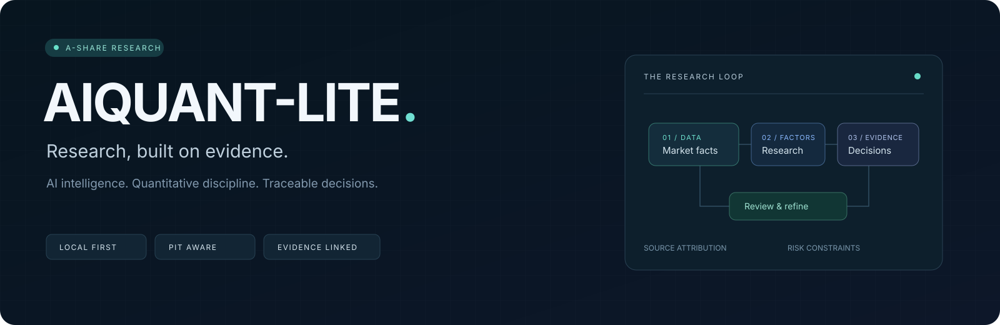
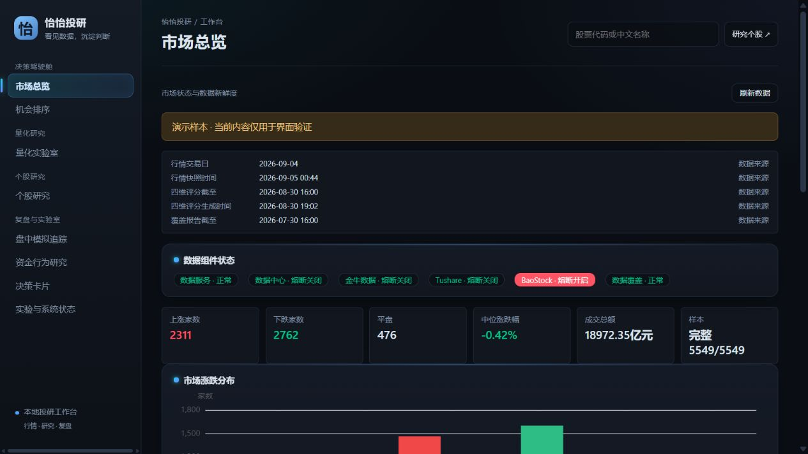
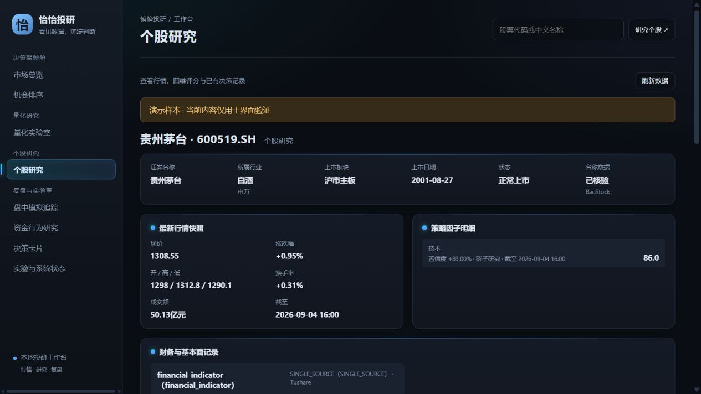
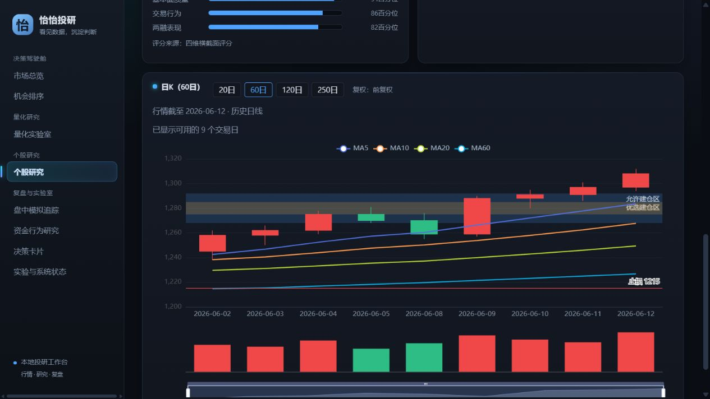
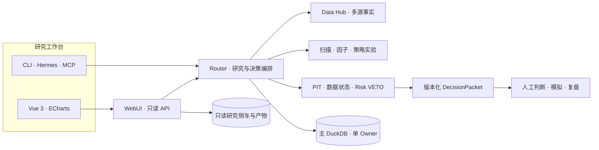

<div align="center">



# AIQUANT-LITE · 怡怡投研

### 面向 A 股的 AI 原生投研工作台

**让市场数据形成研究，让研究沉淀为可追溯的判断。**

把多源数据、量化因子、AI 研究、风险约束与决策复盘，汇入一套本地优先的投研系统。

[](pyproject.toml)
[](frontend/package.json)
[](router/api/app.py)
[](database/connection_manager.py)
[](LICENSE)
[](https://github.com/Shixi216/aiquant-lite/actions/workflows/ci.yml)

简体中文 · [English](README.en.md)

[产品能力](#产品能力) · [开源对标](#开源对标) · [系统架构](#系统架构) · [快速开始](#快速开始) · [质量验证](#质量验证)

</div>

---

## 一套工作台，贯穿投研全流程

AIQUANT-LITE 面向个人研究者、量化开发者和小型研究团队，围绕 A 股研究的实际链路构建：**观察市场 → 筛选机会 → 研究个股 → 检查风险 → 留存决策 → 模拟复盘**。

前端提供多视图投研工作台；后端用结构化数据、确定性计算和可选的模型角色组织研究。每个结论都尽量保留来源、时点、覆盖率和状态，让使用者能够继续追问“依据是什么”。

### 产品预览



<details>
<summary><strong>查看个股研究与 K 线视图</strong></summary>





</details>

> 截图来自实际界面的开发契约样本，数值仅用于展示布局与交互，不代表实时行情、投资建议或收益表现。演示模式在生产环境中禁用。

## 产品能力

| 工作区 | 研究体验 | 对应实现 |
|---|---|---|
| **市场驾驶舱** | 市场涨跌分布、覆盖率、行情时点、数据组件与风险状态集中呈现 | [Dashboard](frontend/src/views/DashboardView.vue) |
| **机会排序** | 全市场确定性扫描、候选筛选、四维横截面评分与分位数展示 | [Scanner](trading/scanner) · [Cross Section](trading/research/orchestration/cross_section.py) |
| **个股研究** | 证券身份、行情快照、财务记录、因子拆解、冻结决策区间与 K 线联动 | [Stock Intelligence](frontend/src/views/StockIntelView.vue) |
| **量化实验室** | 市场情绪、两融、龙虎榜、日线计算与研究面板 | [Quant Lab](frontend/src/views/QuantLabView.vue) |
| **策略与资金研究** | 情绪实验、资金行为产物、Walk-Forward、成本敏感性与策略比较 | [Strategy Lab](trading/research/strategy_lab) · [Research](webui/routes/research.py) |
| **决策与复盘** | 风险 VETO、动作与仓位约束、版本化决策包、本地模拟和手工事实账本 | [Decision Support](trading/decision_support) · [Manual Tracking](manual_tracking) |

### 工程能力

- **数据有出处**：整合 Tushare、AKShare / Eastmoney、BaoStock、CNInfo 等适配器；保留来源、校验状态与缺失信息。金牛历史数据适配作为可选实验能力，需单独配置。
- **AI 有分工**：研究综合、公告核验、风险复核等角色通过 Router 分配给可配置模型；模型可用性取决于凭证、服务和角色配置。
- **时间有语义**：区分交易日、行情快照时间、评分截止时间与报告生成时间，按 Point-in-Time 契约约束研究输入。
- **决策可追溯**：DecisionPacket 冻结区间、记录版本、关联证据并校验哈希；展示层读取已有决策。
- **异常可见**：数据缺失、过期、来源不可达或分数降级都有明确状态；缺失值保留为空。
- **调用可核对**：按时间窗查询物理模型调用，覆盖独立研究链路，汇总成功、失败与未关联任务的记录；保留已知用量，错误信息脱敏展示。见 [调用审计 API](docs/api-reference.md#recent-model-calls)。
- **入口可组合**：Web 工作台、CLI、FastAPI、Finance Data MCP、Hermes 集成与桌面源码共用研究基础设施。

## 开源对标

以成熟开源基础设施为架构参照，聚焦 **A 股、本地研究和决策证据链**。下表比较产品方向，不宣称功能、市场覆盖、性能或收益等价。

| 参照项目 | 官方定位与优势方向 | AIQUANT-LITE 的聚焦点 |
|---|---|---|
| **[Microsoft Qlib](https://github.com/microsoft/qlib)** | 面向 AI 的量化投资研究平台，支持多种机器学习研究范式 | 把因子、策略实验与可读决策结果连接到日常 A 股研究工作流 |
| **[OpenBB](https://github.com/openbq-org/OpenBB)** | 为分析师、量化研究者与 AI Agent 提供数据集成基础设施 | 组织 A 股数据来源、覆盖状态与多视图投研界面 |
| **[QuantConnect LEAN](https://github.com/QuantConnect/Lean)** | 模块化算法交易引擎，覆盖策略研究、回测与执行基础设施 | 在研究与模拟范围内沉淀策略证据、风险约束和复盘记录 |

这些项目是对标参照，并非本项目的依赖或合作方。AIQUANT-LITE 当前定位为研究与人工决策支持；公开实现不接入券商、不自动提交实盘订单。

## 系统架构



**Router 是主 DuckDB 的在线唯一 Owner。** WebUI 的事实与评分请求通过 Router；图表和实验视图可读取明确许可的只读侧车库与研究文件。离线维护主库前需停止持有主库的在线服务。

### 评分与风险边界

当前代码包含多条有明确来源的评分路径，不能混称为同一种分数：

| 路径 | 当前语义 |
|---|---|
| `cross_section_4d` | 技术 / 基本面 / 情绪特征 / 两融的横截面 rank，按 30 / 30 / 25 / 15 对可用项归一化；指定 cutoff 时读取不晚于该时点的历史截面 |
| `legacy_60_40_fallback` | 横截面不可用时回退技术 60% + 基本面 40%，显式标记 `degraded` |
| 编排实验接口 | 支持两因子、50 / 35 / 15 三因子及自定义权重研究；与上述横截面分数分开解释 |

动作还受数据状态、持仓上下文、分位数阈值与风险 VETO 约束。更多说明见 [架构文档](docs/architecture.md) 和 [当前限制](docs/limitations.md)。

## 快速开始

需要 **Python 3.11**、[uv](https://docs.astral.sh/uv/)；构建 Web 工作台另需 **Node.js 22.12+** 与 npm。项目提供 Windows 运维脚本；其他系统可分别启动 Python 服务。

### 1. 安装与配置

```powershell
git clone https://github.com/Shixi216/aiquant-lite.git
cd aiquant-lite
uv sync --dev --frozen
Copy-Item .env.example .env
npm --prefix frontend ci
npm --prefix frontend run build
```

按需填写本地 `.env` 的数据与模型凭证。开源代码不附带授权数据、个人数据库或实验结果；完整研究链需要自行配置数据源并建立本地数据。

### 2. 启动工作台

Windows 上使用项目内脚本统一管理服务：

```powershell
powershell -ExecutionPolicy Bypass -File scripts\start_hermes_opc.ps1
powershell -ExecutionPolicy Bypass -File scripts\status_hermes_opc.ps1
```

打开 [本地投研工作台](http://127.0.0.1:8767)。Router 默认端口为 `8765`，Data Hub 为 `8766`。首次使用可运行 `uv run python -m scripts.preflight_check` 查看配置与服务状态。

也可在不同终端分别启动：

```powershell
uv run python -m scripts.run_router_api
uv run python -m scripts.run_data_api
uv run python -m scripts.run_web_ui --host 127.0.0.1 --port 8767
```

### 3. 只看演示界面

完成前端构建后，可单独启动隔离的界面样本，无需数据凭证或启动 Router：

```powershell
$env:WEBUI_DEV_FIXTURES="1"
$env:HERMES_ENV="development"
$env:ROUTER_URL="http://127.0.0.1:9"
uv run python -m scripts.run_web_ui --host 127.0.0.1 --port 8877
```

访问 `http://127.0.0.1:8877`；市场总览、机会排序与示例个股页面显示契约样本，其余视图会按缺失数据降级。结束演示后在新终端启动正常服务，或清除以上环境变量。

## 代码地图

```text
frontend/                  Vue 3 + TypeScript + ECharts 工作台
webui/                     GET-only 展示 API、图表链与研究产物读取
router/                    模型路由、研究编排、审计与统一 API
data_hub/                  行情、历史、财务、公告与市场数据
trading/scanner/            全市场扫描、查询与候选排序
trading/decision_support/   评分解析、风险、动作、仓位与决策包
trading/research/           因子、情绪、基本面与策略实验
trading/simulation/         本地模拟与组合研究
manual_tracking/           人工录入的外部成交事实
desktop/                   PySide6 桌面源码
database/migrations/       数据库结构演进
scripts/                   运维、研究与验证入口
tests/                     单元、接口、隔离与回归测试
```

## 质量验证

本次 Windows / Python 3.11.1 环境中，长时间混合进程测试出现原生崩溃；当前验证入口采用逐模块独立进程。已验证范围与该限制均记录在下方审核报告中。

```powershell
uv run ruff check .
uv run python -m scripts.run_offline_tests --workers 2
uv run python -m scripts.check_no_live_execution
npm --prefix frontend test
npm --prefix frontend run build
```

验证应在独立环境和临时数据库中进行。当前发布审核记录见 [Release Audit](docs/release-audit-2026-10-18.md)；测试结论只覆盖记录中的环境与范围。外部服务连通性、真实数据质量和长期策略表现需要另行验证。

## 文档与路线

| 了解系统 | 使用与运维 | 深入研究 |
|---|---|---|
| [系统架构](docs/architecture.md) | [API](docs/api-reference.md) | [因子编排](docs/five-factor-orchestration.md) |
| [数据管线](docs/data-pipeline.md) | [运维手册](docs/operations.md) | [策略实验](docs/experiments.md) |
| [安全边界](docs/security.md) | [Hermes 集成](docs/hermes-integration.md) | [PIT 基本面](docs/fundamental-point-in-time.zh-CN.md) |

下一阶段聚焦：**数据质量度量、评分来源一致性、策略证据积累、研究可复现性与工作台交互完善**。规划内容不作为已经交付的能力。

## 安全与许可

凭证只放在本地 `.env`；数据库、日志、缓存、运行状态和个人研究产物不进入公开仓库。服务默认绑定本机，远程使用需自行配置认证与网络控制。漏洞反馈见 [SECURITY.md](SECURITY.md)，贡献方式见 [CONTRIBUTING.md](CONTRIBUTING.md)。

本项目用于研究、教育、回测、模拟与人工决策支持，不构成投资建议，不承诺收益。第三方数据与模型的使用须遵守相应服务条款。源码采用 [MIT License](LICENSE)。
